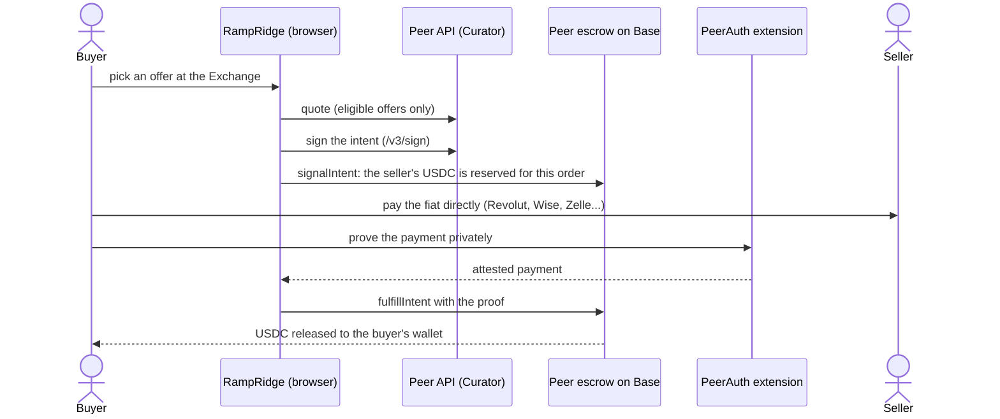
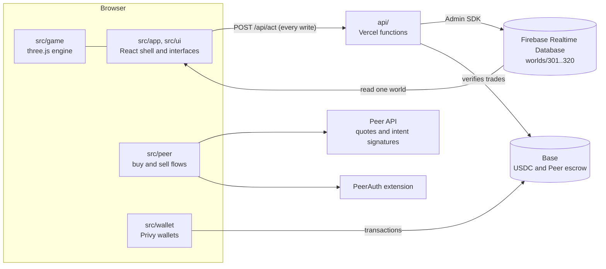

# RampRidge

**Old School RuneScape's Varrock West Bank, rebuilt as a live peer-to-peer USDC exchange.**

[](https://github.com/ADWilkinson/rampridge/actions/workflows/ci.yml)
[](https://www.rampridge.xyz)
[](LICENSE)

[](https://www.rampridge.xyz)

RampRidge is a browser game and a working exchange at the same time. You walk
into the bank, chat with other players, and buy or sell USDC for real money
with Revolut, Wise, Zelle, Cash App, Venmo, PayPal, Monzo and more. Every
trade settles through the [Peer protocol](https://peer.xyz) (ZKP2P) on Base:
buyers pay sellers directly, prove the payment privately with the PeerAuth
browser extension, and Peer's escrow contract releases the USDC. RampRidge
never holds anyone's funds. The world is the original 2007-era bank, rendered
with three.js and decoded from the game cache on your machine, with the
original interfaces rebuilt in React.

**Play it: [www.rampridge.xyz](https://www.rampridge.xyz)**

> RampRidge is an unofficial fan project. RuneScape and Old School RuneScape
> are trademarks of Jagex Ltd. RampRidge is not affiliated with or endorsed by
> Jagex, and this repository contains none of the game's art, models, sounds or
> fonts (see [Game assets](#game-assets)).

## Contents

- [Features](#features)
- [How it works](#how-it-works)
- [Architecture](#architecture)
- [Getting started](#getting-started)
- [Testing](#testing)
- [Documentation](#documentation)
- [Project status](#project-status)
- [Contributing](#contributing)
- [Credits](#credits)
- [License](#license)
- [Disclaimer](#disclaimer)

## Features

- **A living bank.** Walk on the original tile grid at the original 600 ms
  tick, right-click for "Choose Option" menus, chat with the original
  overhead effects (`red:wave:hello`), emote, and switch between numbered
  worlds (301, 302, ...) like the original game.
- **Buy USDC with fiat.** Pick the best live offer at a bank booth's Exchange
  (modelled on the Grand Exchange), or trade with a merchant NPC who shouts a
  real offer. Pay the seller directly, prove the payment with PeerAuth in
  Chrome or Brave on a computer, and the contract releases the USDC to your
  wallet.
- **Sell USDC for fiat.** Deposit USDC at the bank with your payout handle.
  Orders are priced at the live oracle rate, with an optional spread of -5% to
  +5%, and appear in the bank as items with their fills. Advertise one as a
  stall and other players in your world can trade with you.
- **Send and receive.** The USDC sits in your own wallet: send it to any Base
  address after a full review, or show your address and QR code to fund a sale.
- **Logins without friction.** Email, Google, an existing Peer account or any
  wallet, through Privy. Email and Google logins get a smart wallet on Base
  whose gas is sponsored.
- **Built against scams.** Chat filters payment handles, links, wallet
  addresses and contact details, because off-protocol trades are how people
  get robbed. Trades only settle through the bank's interfaces.
- **Coverage.** Buying spans 11 payment methods (including beta Alipay, UPI
  via Amazon Pay and X Money) and selling 11 platforms, both in the 11 major
  currencies Peer prices with a live oracle (USD, EUR, GBP, CAD, AUD, NZD,
  CHF, SGD, MXN, CNY, INR). The full matrix is in
  [docs/design.md](docs/design.md#currencies-and-payment-methods).

## How it works

### The game

The engine (`src/game`) is plain three.js with no React: an OSRS-style camera,
tile pathfinding on the bank's real collision map, picking and context menus,
overhead chat effects, a minimap, and a port of the original model animation
runtime for players and NPCs. The interfaces (`src/ui`) are React components
drawn over the canvas with the original sprites and fonts: the chatbox, side
panel, bank, Grand Exchange, trade screens, dialogue and character designer.

### Game assets

None of that art lives in this repository. `scripts/bake` decodes the Old
School RuneScape cache (downloaded from the [OpenRS2 Archive](https://archive.openrs2.org))
into `public/game` on your machine: the bank region as a GLB model, the
collision grid, the minimap, interface sprites, sounds, fonts and character
data. `scripts/bake/assets.lock.json` pins the cache production was baked
from and the size and SHA-256 of every file it serves, so a fresh clone can
rebuild the same assets and check them.

### Realtime worlds

The bank runs as numbered worlds, each with its own players, chat and stalls,
on Firebase Realtime Database. Browsers may read one world at a time and
nothing else (`database.rules.json`). Every write goes through `POST /api/act`,
a Vercel function that authenticates the player's session token, validates
the action, rate-limits it and filters chat before writing with the Admin SDK.

A move writes only the path, a server start time and the run flag; every
client replays it deterministically (`shared/protocol.ts`). The server places
each arrival in the busiest world below 70% of its cap, so a quiet evening is
one lively bank rather than three empty ones. Operators open, cap and close
worlds from the database with no deploy. A world's realtime traffic grows with
the square of its size, so splitting players across worlds keeps the bill
down; `docs/runbook.md` has the measured numbers.

### Buying USDC



The buyer has six hours to prove the payment. Peer's fee and RampRidge's 0.5%
fee come out of the USDC received, and every confirm screen lists them.
RampRidge waives its fee when the seller's order carries its Peer referral
code, because Peer's referral share already pays it on those.

### Selling USDC

A seller deposits USDC into Peer's escrow contract with one or more payout
handles. Buyers anywhere on Peer, in RampRidge or elsewhere, fill the order at
the live oracle rate plus the seller's spread, and USDC only moves when a buyer
proves they paid. Sellers top up or withdraw their orders from the bank.

### Non-custodial by design

- Funds only ever sit in the player's own wallet or in Peer's escrow
  contract on Base. RampRidge has no hot wallet and no custody.
- Fiat goes straight from buyer to seller. RampRidge never sees payment
  credentials; the PeerAuth extension proves a payment without revealing the
  account behind it.
- The server stores game data (players, chat, names, stalls, and a wallet
  address only if a player verifies one) and scrubbed telemetry. It checks
  announced trades on Base before it tells the room.

## Architecture



| Path | What it holds |
|---|---|
| `src/app` | React shell: boot, screens (loading, title, character design, game), providers, the global store |
| `src/game` | three.js engine (no React): world, entities, OSRS model animation, camera, input and picking, pathfinding, overhead text, minimap |
| `src/ui` | OSRS-styled interfaces drawn over the canvas: frame, side panels, bank, Exchange, trade, payment scroll, send, dialogue; `src/ui/kit` is the shared component kit |
| `src/net` | Realtime client: session token, world subscription, actions, world switching |
| `src/peer` | Peer protocol flows on `@zkp2p/sdk` and `@zkp2p/cash`: quotes, intents, payment proofs, deposits, refresh-safe recovery |
| `src/wallet` | Privy login, smart-wallet and external-wallet transaction senders, USDC send |
| `api` | Vercel functions: `session`, `act` (every world write), `worlds`, `market`, `wallet`, `log`, `health`, `share`, `og`, and the prune cron |
| `shared` | Wire protocol, movement replay, world rules, chat and name filters, shared by the API and the browser |
| `scripts/bake` | Asset pipeline from the OSRS cache to `public/game` |
| `scripts/ops`, `scripts/load` | Operator scripts (status, moderation, stuck orders) and emulator-only load and abuse tests |
| `dev` | Development harness pages for the engine, interfaces and UI kit |
| `tests` | Fork, parity and end-to-end suites that run outside `bun run check` |

The title screen downloads only the shell, the engine and the game assets.
The realtime client, Peer SDKs, Privy and WalletConnect load once the title
is idle or the player needs them; `src/app/titleGraph.test.ts` keeps them out
of the title's static import graph. [CLAUDE.md](CLAUDE.md) goes deeper on
every part.

## Getting started

### Prerequisites

- [Bun](https://bun.sh) 1.2 or newer
- Node.js 22.18 or newer (Vite and the scripts run on it)
- The [Firebase CLI](https://firebase.google.com/docs/cli) and Java 17 or newer, for the Realtime Database emulator. No Firebase account is needed.
- `unzip`, for the bake's font download
- Chrome or Brave with the [PeerAuth extension](https://chromewebstore.google.com/detail/peerauth-authenticate-and/ijpgccednehjpeclfcllnjjcmiohdjih), only if you want to prove payments

### Run it locally

```bash
git clone https://github.com/ADWilkinson/rampridge.git
cd rampridge
bun install

# Decode the game assets into public/game from the cache production was baked from.
# Downloads about 190 MB once (the cache and the fonts); later runs reuse .cache/.
bun run setup:assets

# Local settings: the defaults point the API at the emulator.
cp .env.example .env.local

# Terminal 1: the Realtime Database emulator on 127.0.0.1:9460
bash scripts/load/emulator.sh

# Terminal 2: the game and its API on http://localhost:5173
bun run dev
```

Working on the bake itself? `bun run bake` re-bakes from the cache in
`.cache/osrs` and rewrites the asset lock; [scripts/bake/README.md](scripts/bake/README.md)
covers the pipeline.

Open http://localhost:5173 and press **Play now**. The dev server serves the
Vercel functions in `api/` through a Vite plugin (`scripts/dev-api.ts`), and
both the API and the page use the emulator, never a live database. The API
answers 503 until `FIREBASE_DATABASE_EMULATOR_HOST` is set, so a missing
setting can't write anywhere real. Keep port 5173: it is the local origin the
production Privy client allows, so logging in works locally too.

> **Real money.** The local game talks to Base mainnet and Peer's production
> API. Buying, selling or sending from a local build is a real transaction
> with real funds. Use small amounts, or test the money paths on a fork
> ([Testing](#testing)).

### What each feature needs

| To work on | You need |
|---|---|
| The engine, interfaces and UI kit (`/dev/*.html`) | The baked assets only |
| Joining a world, moving, chat, world switching | The emulator and `SESSION_SECRET` (both in `.env.example`) |
| Merchants' live offers and buy quotes | Network access to Peer's public API (no key) |
| Logging in | Nothing extra on port 5173 |
| Announced trades and stalls (the server checks them on Base) | `BASE_RPC_URL` (the public endpoint is fine) |
| Buying, selling and sending | A wallet with real USDC on Base, and PeerAuth to prove a payment |
| The prune cron | `CRON_SECRET`: call `GET /api/cron/prune` with `Authorization: Bearer <secret>` |

`.env.example` documents every variable.

### Development harnesses

With `bun run dev` running, these pages exercise one part at a time with
fixtures instead of live data:

| Page | What it shows |
|---|---|
| `/dev/ui.html` | The UI kit gallery |
| `/dev/bank.html`, `/dev/buy.html`, `/dev/send.html` | The bank, buy and send interfaces in every state |
| `/dev/dialogue.html` | Dialogue, How it works and Terms |
| `/dev/engine.html` | The engine with simulated players, merchants and a stall (`?debug=1` draws the collision grid) |
| `/dev/actors.html` | Player and NPC models, walking, running and every emote |
| `/dev/bake.html` | Each baked output: world, minimap, sprites, items, interfaces |
| `/src/app/dev/shell-screens.html` | The shell's full-screen states and the HUD over fake wallet data |

## Testing

| Command | What it checks | Needs |
|---|---|---|
| `bun run check` | Typecheck, lint (oxlint), the unit tests (Vitest), production build. Every change must pass it, and CI runs it on every push and pull request. Tests that read the baked assets skip when `public/game` is absent. | `bun install` |
| `bun run test:fork` | The buy and sell money paths against Peer's deployed contracts on a local anvil fork of Base: deposits, intents, proofs, releases, smart wallets | [Foundry](https://getfoundry.sh)'s `anvil`, `FORK_UPSTREAM_RPC_URL`, network access to Peer's API |
| `bunx vitest run -c tests/send-fork/vitest.config.ts` | The USDC send path, including a send whose outcome was lost | `anvil`, `FORK_UPSTREAM_RPC_URL` |
| `bun run test:parity` | The buy path's intent signals, field by field, against the Peer web app's code and its real transactions on Base (`tests/buy-parity/golden` replays real fulfilments with its own config) | `anvil`, an archive-capable `FORK_UPSTREAM_RPC_URL`, network access |
| `bunx vitest run --config dev/buy-e2e/vitest.e2e.config.ts` | A full buy through the real interface in headless Chrome, on a fork | Chrome, `anvil`, `FORK_UPSTREAM_RPC_URL` |
| `scripts/load` | Load and abuse tests: crowded worlds, floods, forged tokens | The emulator; see [scripts/load/README.md](scripts/load/README.md) |

`FORK_UPSTREAM_RPC_URL` is a Base mainnet RPC URL (for example an Alchemy
endpoint). The suites keep it out of their output, and they never send
anything to mainnet: transactions land only on the local fork, and the parity
suite reaches mainnet through a proxy that refuses every method that could
send or sign. [tests/fork/README.md](tests/fork/README.md) describes exactly
what is real and what is stood in.

## Documentation

| Document | Covers |
|---|---|
| [CLAUDE.md](CLAUDE.md) (also `AGENTS.md`) | Architecture in depth, conventions and guardrails, for contributors and their coding agents |
| [docs/design.md](docs/design.md) | The product spec: screens, interfaces, every state, the currency and payment matrix |
| [docs/runbook.md](docs/runbook.md) | Operating production: deploys, worlds and their costs, incidents, moderation |
| [tests/fork/README.md](tests/fork/README.md), [tests/send-fork/README.md](tests/send-fork/README.md) | The fork suites |
| [scripts/bake/README.md](scripts/bake/README.md) | The asset pipeline |
| [scripts/load/README.md](scripts/load/README.md) | Load and abuse testing, with measured results |
| [scripts/og/README.md](scripts/og/README.md), [scripts/launch/README.md](scripts/launch/README.md) | Link preview cards and launch media |

## Project status

RampRidge has been live since October 2026 and is actively maintained. The
scope is deliberately one room: everything in the original game that isn't
the bank is left out. Ideas that fit that room are welcome; see
[docs/design.md](docs/design.md#deferred-and-why) for what was deferred and why.

## Contributing

Contributions are welcome: bug fixes, interface fidelity to the 2007 client,
performance, accessibility, and new payment methods as Peer adds them.
RampRidge is one live bank rather than a template, so an improvement merged
here reaches every player on the next deploy.

- Read [CONTRIBUTING.md](CONTRIBUTING.md) first, especially the rules for the
  code paths that move money.
- Open an issue before anything bigger than a small fix.
- Report security issues privately, as described in [SECURITY.md](SECURITY.md).

The maintainer reviews pull requests and deploys `main` to production
([docs/runbook.md](docs/runbook.md)). This project follows the
[Contributor Covenant](CODE_OF_CONDUCT.md).

## Credits

- [Peer](https://peer.xyz) (ZKP2P): the protocol every trade settles on, and
  the `@zkp2p/sdk` and `@zkp2p/cash` SDKs (MIT).
- [rs-map-viewer](https://github.com/dennisdev/rs-map-viewer) by dennisdev
  (BSD-2-Clause): the cache decoders the bake vendors, and the model and
  animation code `src/game/osrs` ports.
- [osrscachereader](https://github.com/Dezinater/osrscachereader) by
  Dezinater (BSD-2-Clause): the sound effect synthesiser the bake ports.
- [RuneStar fonts](https://github.com/RuneStar/fonts): TrueType conversions of
  the game's fonts (conversion CC0 1.0; glyph designs Jagex's), fetched at bake time.
- [OpenRS2 Archive](https://archive.openrs2.org): the source of the game cache.
- [Cinzel](https://github.com/NDISCOVER/Cinzel) (SIL Open Font License): the
  RampRidge wordmark.
- [three.js](https://threejs.org), [React](https://react.dev),
  [Privy](https://www.privy.io), [viem](https://viem.sh),
  [Firebase](https://firebase.google.com) and [Vercel](https://vercel.com).

## License

RampRidge's own code is released under the [MIT License](LICENSE). Vendored
third-party code keeps its own license, and the game assets are neither
included nor covered: [NOTICE](NOTICE) has the details.

## Disclaimer

RampRidge is an unofficial fan project. RuneScape and Old School RuneScape are
trademarks of Jagex Ltd. RampRidge is not affiliated with, endorsed by or
sponsored by Jagex. This repository does not contain the game's art, models,
sounds or fonts: the bake decodes them on your own machine from the public
game cache.

Trades are between people and settle through the Peer protocol's smart
contracts; use of the protocol is subject to [Peer's terms](https://peer.xyz/tos).
The software is provided as is, without warranty of any kind. Nothing here is
financial advice, and you are responsible for following the laws where you live.
